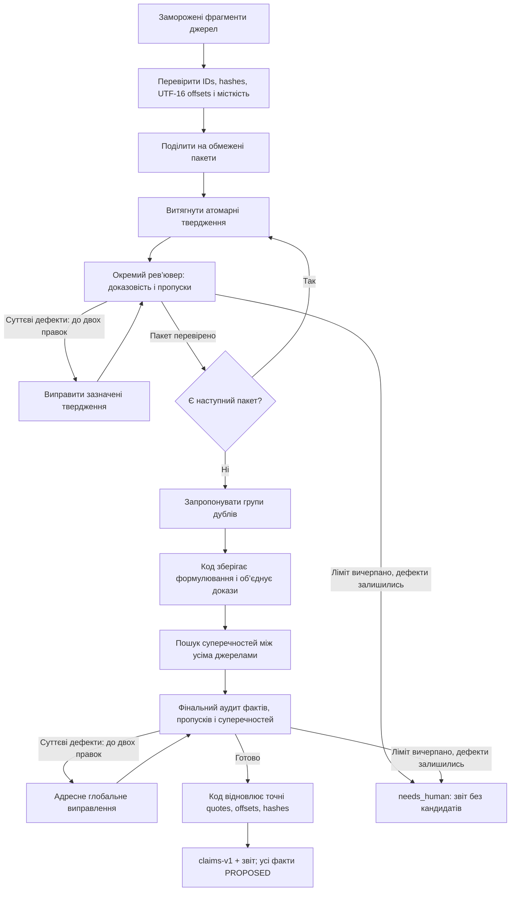

# Витягування фактів із перевіркою доказів

Локальний release `claim-extraction-2026-10-09.2` замінює `Start → LLM → End` на **40 нод із двома окремими Loop**. Ціль сумісності — Dify **1.17.1**, Graphon **0.7.0**. Контракт результату `claims-v1` збережено; додано обов’язковий `extraction_report`. Погодження фактів і вибір правильної версії суперечливого твердження залишаються діями людини.

Сумісність із Gemini: модельні JSON-схеми описують максимальну кількість елементів без native `maxItems`; усі жорсткі межі залишаються в Code-нодах. Усі шість типів схем цього workflow прийняті прямими Gemini API запитами 2026-10-09. Це не замінює публікацію й повний прогін у Dify. [Результати](../../../../../../docs/LIVE_DIFY_CHECK_2026-10-09.md).



## Що змінилося

Екстрактор повертає лише `key`, `wording` і evidence `{fragmentId, relation}`. Він не копіює цитати, хеші чи offsets. Код перевіряє посилання і формує фінальні evidence records із незмінних вхідних фрагментів. Точність метаданих контролюється програмно; змістова відповідність твердження джерелу перевіряється моделлю й людиною.

Рев’ювер кожного пакета перечитує джерела незалежно від екстрактора. Він перевіряє підтримку кожного твердження, атрибуцію, числа, одиниці, дату, умови, заперечення, причинність і ступінь упевненості. Окремий прохід шукає важливі пропущені твердження. На кожний фрагмент потрібен запис `coverage`: поточні claim keys або `no_factual_claims`. Наявність посилання сама по собі не доводить повноту; для змістових пропусків рев’ювер повинен створити major/critical finding. Порожній результат допустимий лише після перевірки всіх джерел.

Дедуплікатор пропонує partition усіх кандидатів: кожен key рівно один раз, у групі чи окремо. Код зберігає перше формулювання та об’єднує evidence без втрати посилань. Різні періоди, умови, вибірки, атрибуції чи ступені впевненості мають залишатися різними фактами. `preMergeClaims` зберігає формулювання до об’єднання, щоб фінальний аудитор міг виявити втрачений окремий факт і попросити його відновити.

Окремий рев’ювер суперечностей порівнює кандидати між джерелами. Несумісні дані за однакових умов утворюють proposed conflict; відмінні роки чи визначення автоматично конфліктом не стають. Правильно позначений конфлікт не блокує витяг: він передається на людський розгляд без вибору «правильного» джерела. Фінальний аудитор перевіряє як знайдені, так і можливі пропущені чи помилкові конфлікти.

## Захист правок

- Рев’ю і патч посилаються на точний `versionHash`; після глобального патча попередній аудит скидається.
- Зауваження має існуючий claim/source locator і дослівну цитату з актуального формулювання або джерела. Довільні чи застарілі findings відхиляються.
- Editor повертає повний поточний список, але незазначені в feedback твердження мають залишитися незмінними. Нові факти дозволені для виправлення пропусків або поділу зазначеного складеного твердження.
- Глобальна правка не може втратити фрагменти, які вже мали SUPPORTS. Якщо єдине твердження фрагмента непідтримане, потрібне коректне підтверджене формулювання або людське втручання.
- Сторонні конфлікти, яких не стосуються findings/їхні учасники, мають зберегтися. Зміна чи додавання конфлікту повинна стосуватися зазначених тверджень/джерел.
- Вичерпання `loop_count` перевіряється окремим guard після контейнера; це не ознака успіху. Незняті суттєві findings блокують весь кандидатний результат, а не залишають частково «готові» факти.
- Native retries і зовнішні модельні tools вимкнені. Відомий provider run відновлюється через GET того самого run; неоднозначний POST не повторюється автоматично.

## Контракт і місткість

Вхід `sources_json` збережено: JSON-рядок масиву snapshots із `snapshotId`, `materialId`, snapshot `sha256` і `fragments[{id,startOffset,endOffset,sha256,text}]`. Runtime перевіряє SHA-256 фрагмента, довжину його UTF-16 range та незмінність усього пакета. Повний snapshot hash/ancestry перевіряє бекенд: повний snapshot text не передається в Dify, якщо він не входить у вибрані фрагменти.

| Ліміт | Значення |
| --- | --- |
| Заморожений вхід / стан / кожен модельний запит / фінальний JSON | До 350000 UTF-8 bytes кожен |
| Пакети | До 30, по 8 фрагментів і 40000 bytes розширених source rows |
| Фрагмент | До 10000 UTF-16 units, без поділу immutable фрагмента |
| Кандидати | До 30 на пакет і 100 загалом; до 10 evidence entries на факт |
| Конфлікти | До 100, по 2–10 різних учасників |
| Правки пакета / фінального результату | 2 / 2 |
| Native Loop counts | 90 / 3 |
| Модельні виклики | Guard 200; найбільший штатний шлях 187 |
| Deadline ContentFlow | 1 година; remote Dify/provider може мати нижчі власні ліміти |
| Звіт | До 256000 bytes |

Без правок потрібні `2 × кількість пакетів + 3` виклики: extractor/reviewer на пакет, дедуплікатор, рев’ювер суперечностей, фінальний аудит. Модельні ролі використовують поточний pinned `gemini-3.8-flash` із Low thinking; різні prompts не забезпечують незалежності помилок різних моделей.

Граничний розмір входу не гарантує, що джерела разом із усіма майбутніми кандидатами помістяться у глобальний запит. Runtime до модельних викликів перевіряє мінімальний глобальний envelope, а кожен наступний запит — із фактичними кандидатами та історією до merge. Завеликий контекст, понад 100 важливих фактів, надлишок evidence або повторених великих цитат завершують run явною помилкою. Прихованого обрізання джерел/фактів немає. Для більших корпусів потрібен окремий дизайн пагінації глобального аудиту; збільшувати лише `max_length` недостатньо.

Виходи End:

- `claims_json`: JSON-рядок незмінного `claims-v1`, включно з exact evidence і proposed conflicts; порожній рядок при блокуванні.
- `extraction_report`: JSON-рядок `claims-extraction-report-v1`, `ready`/`needs_human`, причина, input/final hashes, кількість викликів/правок, історія пакетів, незняті зауваження, `humanApprovalRequired: true`, `semanticChecks: model_review_not_proof`.

Бекенд вимагає `ready` на SSE завершенні й GET reconciliation, потім перевіряє `claims-v1`, frozen evidence, exact quotes, hashes та Project ancestry перед атомарним commit. Missing/malformed report або неготовий результат не створює часткових claim revisions. Витягнуті твердження залишаються PROPOSED; AI не формує approved factual basis.

Звіт доступний у Dify run output; його окреме збереження у БД та UI findings ще не реалізовані. Застосунок показує блокований run як невдале завдання із загальною причиною втручання. Нова міграція БД не потрібна. SSE metadata обмежено 128 MiB загалом/64 MiB на event, run-detail — 2 MiB, канонічний provider candidate — 500000 bytes; native Code output обмежено 350000 bytes.

## Файли й перевірки

Джерела: `prompt.md`, `scripts/dify/claim_extraction_runtime.py`, `scripts/dify/build_claim_review_dsl.py`. Попередня команда генерації `build_claim_extraction_dsl.py` делегує новому builder. Shared baseline envelope збережено для article/outline builders; їхні DSL не змінюються через оновлення extraction.

```powershell
.\.venv-dify-validator\Scripts\python.exe -B scripts/dify/build_claim_extraction_dsl.py
.\.venv-dify-validator\Scripts\python.exe -B scripts/dify/test_claim_extraction_runtime.py
.\.venv-dify-validator\Scripts\python.exe -B scripts/dify/test_claim_extraction_graph.py
.\.venv-dify-validator\Scripts\python.exe -B scripts/dify/validate_dify_dsl.py packages/backend/src/claims/workflows/claim-extraction/claim-extraction-v1.yml --graphon-version 0.7.0 --profile admin-panel-reference
node scripts/dify/verify_release.mjs
pnpm test:unit
pnpm test:integration -- tests/integration/claim-extraction.test.ts
```

Builder фіксує prompt/runtime/DSL hashes і config digest; після регенерації треба синхронізувати runtime та тестові pins, які verifier перевіряє. Graph-тести читають саме згенерований YAML і виконують його на реальному Graphon; лише LLM і executor sandbox підставні. Це перевірка переходів, bounds і контрактів, не реального Gemini чи Dify sandbox.

## Перед використанням remote release

1. Імпортувати `claim-extraction-v1.yml` у тестовий Dify Workflow workspace, перевірити версію сервера, Gemini plugin/model і Code sandbox. `release.json` є metadata, не DSL.
2. Окремо перевірити import, publish-check і синтетичні живі прогони: кілька джерел, дублікати, суперечливі дані, умовне твердження, пропуск, текст без фактів. Перевірити видимі невдалі результати.
3. Вручну оцінити пропуски, атомарність, entailment, хибні merge/conflicts, кількість ручних правок, час і токени проти попереднього workflow. Програмні тести не доводять семантичну якість.
4. Після прийняття опублікованого графа налаштувати server-side app key, published workflow UUID та актуальний `DIFY_CLAIM_EXTRACTION_CONFIG_SHA256`. Existing environment credentials/pins тут збережено; старий опублікований workflow не сумісний із новою обов’язковою report gate.

Remote import, publication і платні модельні прогони не виконувалися під час локальної реалізації. [Dify Loop](https://docs.dify.ai/en/cloud/use-dify/nodes/loop) документує state, termination conditions та maximum count; версійна база — [Dify1.17.1 Graphon pin](https://github.com/langgenius/dify/blob/1.17.1/api/pyproject.toml) і [availableBlocksFilter](https://github.com/langgenius/dify/blob/1.17.1/web/app/components/workflow/hooks/use-available-blocks.ts), який виключає вкладені Loop/Iteration у редакторі цієї версії.
