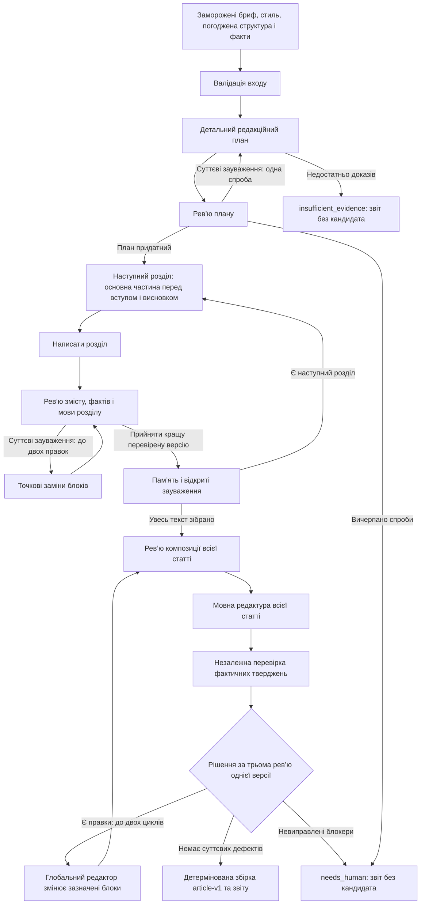

# Редакційний workflow статті

Локальний release `article-generation-2026-10-09.2` замінює одноразову генерацію на планування, послідовне написання з рев’ю та перевірку цілого тексту. Артефакт містить **51 ноду і 3 окремі Loop**. Ціль сумісності — Dify **1.17.1**, Graphon **0.7.0**; імпорт, publish-check та живий модельний прогін у конкретному Dify workspace перевіряються окремо.

Сумісність із Gemini: native `maxItems` замінено описом межі в модельних JSON-схемах. Code жорстко перевіряє всі межі, включно з 60 блоками розділу, 60 адресними замінами та 12 пунктами paragraphPlan/avoidRepeating. Усі чотири типи схем прийняті прямими Gemini API запитами 2026-10-09; повний Dify прогін потрібний після публікації.

## Схема



Погоджена користувачем структура є незмінним входом. Планувальник деталізує питання читача, тезу, абзаци, бюджет слів, факти, переходи, термінологію та теми, які не треба повторювати. Змінити назву, порядок чи призначення погоджених розділів може лише людина. Вступ і висновок відкладаються, коли їхні ролі відповідають наявній структурі; нові розділи автоматично не додаються.

## Ролі та пам’ять

| Роль | Завдання |
| --- | --- |
| Planner + Plan reviewer | Придатність матеріалу, логіка, повнота запиту, розподіл фактів і довжини, відсутність дублювання у плані. |
| Section writer | Один розділ із власною тезою, призначеними фактами та контекстом попередніх розділів. |
| Section reviewer + Section editor | Перевірка актуального розділу і точкові правки за конкретними зауваженнями. |
| Global reviewer | Композиція, обіцянка вступу, логіка аргументу, повтори між розділами, переходи, термінологія, CTA та довжина. |
| Language reviewer | Українська мова, ритм, повтори, канцеляризми, кальки, перевантажені речення, пасивні конструкції та милозвучність у контексті. |
| Factual reviewer | Семантична відповідність тверджень погодженим фактам, умови, числа, атрибуція, ступінь упевненості, непідтверджені узагальнення. |
| Global editor | Мінімальні правки зазначених блоків із наступним повторенням усіх трьох перевірок. |

Пам’ять для наступного розділу містить тезу, використані claim IDs і останній абзац прийнятих розділів. Вступ/висновок додатково отримують уже написані розділи повністю. Глобальні рев’ю завжди бачать увесь текст. Цільова довжина перевіряється в плані та редактором; фінальний word count є метрикою, а не гарантією точної кількості слів.

Мовні правила не є механічною забороною пасиву, довгих речень чи повторення точних термінів. Рев’ювер має показати конкретну проблему та критерій її виправлення. Формульний, порожній текст оцінюється як редакційний дефект; визначати авторство ШІ workflow не намагається.

## Контроль правок і фактів

- Зауваження: `id`, `severity`, `category`, `sectionId`, `blockId`, точна `quote`, `instruction`, `acceptance`. Цитата мусить існувати в поточному блоці. Зауваження до погодженого заголовка може стати блокером для людини.
- Рев’ю і патч містять `versionHash`. Застарілі зауваження/патчі відхиляються. Патч змінює лише названі блоки та зберігає їхні IDs; після зміни старі глобальні рев’ю скидаються.
- Суттєві локальні дефекти, які не знято після двох правок, переходять у `localBlockers`. Глобальні рев’ю мають перевірити їх і явно закрити; сам факт завершення Loop їх не прибирає.
- Локально зберігається краща валідна перевірена версія. Якщо пізніша глобальна косметична правка погіршує текст, можна повернути раніше повністю перевірену версію без суттєвих дефектів. Звіт позначає `restoredEarlierVersion`.
- FACTUAL використовує лише передані погоджені claim revisions і їхні SUPPORTS evidence IDs. Нотатки та зразки стилю не є доказами. Правки не можуть втратити покриття вже використаних чи призначених фактів. Обов’язкові факти перевіряються перед фінальним виходом.
- CREATIVE не має доказових позначок і не отримує статусу фактологічно перевіреного матеріалу.
- Детермінований компілятор формує обмежений Tiptap JSON. Evidence quote дорівнює фактичному тексту позначеного span, зокрема після злиття суміжних однакових посилань.

Перевірка IDs/покриття/хешів є програмною. Перевірка змістової відповідності, природності мови та повноти запиту є модельною і потребує оцінки на реальних прикладах. Усі ролі наразі використовують один зафіксований `gemini-3.8-flash`; поділ ролей не забезпечує незалежності помилок різних моделей.

## Контракт і ліміти

Вхід `editorial_json` — JSON-рядок `article-context-v1`: `contentMode`, `brief`, `style`, погоджений `outline`, `claims`, вибраний `context`. У застосунку цей пакет формує сервер із заморожених версій. Синтетичні приклади є у `scripts/dify/test_article_generation_runtime.py`.

| Обмеження | Значення |
| --- | --- |
| Розділи | 1–30; у плані потрібна основна частина |
| Правки плану / розділу / цілого тексту | 1 / 2 / 2 |
| Проходи контейнерів planning / sections / editing | 2 / 90 / 3 |
| Модельні виклики | Жорсткий guard 200; найбільший штатний шлях — 195 |
| Frozen input / стан / запит моделі | До 350000 UTF-8 bytes кожен; без прихованого обрізання |
| Готовий content / evidence spans / document nodes | До 500000 bytes / 200 / 5000 |
| Редакційний звіт | До 256 KiB |
| Deadline у ContentFlow | 1 година; сервер Dify/модель можуть мати власні нижчі ліміти |

Без правок потрібно `2 × кількість розділів + 5` модельних викликів. Це дорожче й повільніше за одну генерацію; фактичну ціну та якість треба виміряти живим прогоном. Native retries і зовнішні модельні tools вимкнені. Неправильний JSON, references, патч без змін, перевищення розміру або незавершений Loop завершують виконання помилкою; часткова стаття не повертається.

Два виходи End:

- `article_json`: JSON-рядок із попереднім контрактом `article-v1`; порожній рядок при редакційному блокуванні.
- `editorial_report`: JSON-рядок `article-editorial-report-v1`, статус `ready`, `needs_human` або `insufficient_evidence`, причини, input/final hashes, кількість викликів і правок, історія розділів, незняті зауваження, `humanApprovalRequired: true`.

Бекенд вимагає валідний звіт зі статусом `ready`, потім незалежно перевіряє `article-v1` і доменні evidence/dependency правила. Успішний статус самого Dify run недостатній. AI-кандидат залишається незастосованим і непогодженим. Звіт доступний у результаті Dify; окреме збереження звіту в БД та показ у UI ще не реалізовані. Блокований результат у застосунку відображається як невдале завдання із загальною причиною втручання редактора.

## Чому три Loop

У перевіреній версії редактора вкладати Loop/Iteration контейнери не можна. Тому один section Loop керує курсором розділу та його двома правками через стан. Assigner v2 записує `state_json` і `done` у змінні контейнера. Після кожного контейнера окремий guard перевіряє завершення: вичерпання `loop_count` не прирівнюється до готовності статті. Ексклюзивні вихідні гілки зводяться агрегаторами в один End.

## Файли та перевірки

Джерела: `prompt.md`, `scripts/dify/article_generation_runtime.py`, `scripts/dify/build_article_generation_dsl.py`. Згенеровані артефакти: `article-generation-v1.yml`, `release.json`. Builder фіксує SHA-256 промптів, runtime і DSL у release. Після зміни джерел треба перегенерувати артефакти й синхронізувати release/digest/DSL pins у `article-provider.ts`; verifier навмисно відхиляє розбіжність.

Із кореня репозиторію:

```powershell
.\.venv-dify-validator\Scripts\python.exe -B scripts/dify/build_article_generation_dsl.py
.\.venv-dify-validator\Scripts\python.exe -B scripts/dify/test_article_generation_runtime.py
.\.venv-dify-validator\Scripts\python.exe -B scripts/dify/test_article_generation_graph.py
.\.venv-dify-validator\Scripts\python.exe -B scripts/dify/validate_dify_dsl.py --self-test
.\.venv-dify-validator\Scripts\python.exe -B scripts/dify/validate_dify_dsl.py packages/backend/src/editorial/workflows/article-generation/article-generation-v1.yml --graphon-version 0.7.0 --profile admin-panel-reference
node scripts/dify/verify_article_release.mjs
pnpm test:unit
pnpm test:integration -- tests/integration/article-generation.test.ts
```

Graph-тести запускають саме експортований YAML на реальному Graphon 0.7.0. Підставляються тільки LLM-відповіді та локальний executor Code sandbox; реальні Loop, If/Else, Assigner, агрегатори, output bounds і End виконує рушій. Перевіряються FACTUAL/CREATIVE, усі гілки правок, блокування, 30 розділів із 60 локальними правками та примусово скорочений Loop. Це не перевірка реального Dify sandbox, Gemini або якості статті.

## Імпорт і прийняття релізу

1. Імпортувати `article-generation-v1.yml` як Workflow у тестовий Dify workspace; `release.json` не імпортується.
2. Перевірити Gemini plugin/доступність pinned model, structured output та sandbox limits. Зіставити фактичну версію сервера з ціллю; local editor-profile warning не підтверджує cloud compatibility.
3. Окремо перевірити import, publish-check і синтетичний модельний run: FACTUAL, CREATIVE, недостатній матеріал, потрібна зміна погодженого заголовка. Переконатися, що після патчів є фінальні три рев’ю.
4. Прочитати готові тексти вручну за брифом, фактами, мовою, повторами між розділами та довжиною. Зіставити зі старою одноразовою генерацією; виміряти час, токени, витрати та помилкові спрацьовування рев’юверів.
5. Після прийняття опублікованого workflow оновити server-side published UUID, app API key та `DIFY_ARTICLE_GENERATION_CONFIG_SHA256` із актуального `release.json`. Збережені credentials/pins у цьому завданні не змінювались. Сам digest не доводить налаштувань remote app.

Імпорт, публікація та платні виклики не виконувалися в межах локальної реалізації.

## Джерела ідей

- [Anthropic: evaluator–optimizer workflow](https://www.anthropic.com/engineering/building-effective-agents) — окремі генератор і оцінювач, конкретні критерії та повторення до обмеженого результату. Тут цей підхід адаптовано до секцій і фінальної редактури.
- [Dify: Loop](https://docs.dify.ai/en/cloud/use-dify/nodes/loop) — послідовне уточнення зі станом, умовою завершення та maximum loop count.
- [Dify 1.17.1 dependency pin](https://github.com/langgenius/dify/blob/1.17.1/api/pyproject.toml) та [availableBlocksFilter у редакторі цієї версії](https://github.com/langgenius/dify/blob/1.17.1/web/app/components/workflow/hooks/use-available-blocks.ts) — версійна база для Graphon і виключення вкладених Loop/Iteration із доступних блоків контейнера. Це обмеження редактора; правила конкретної cloud installation треба звірити перед релізом.

Це власна реалізація під frozen input і evidence-контракт ContentFlow; готові чужі prompts або domain schemas не переносились.

## Follow-up from real model execution (2026-10-09)

Release 2026-10-09.2 fixes actual prompt interpolation through Jinja. Short valid plans with only introduction/conclusion roles generate the first section as body while preserving approved IDs, titles and purposes. The actual final body must contain 65–135% of brief.targetLength; otherwise the report is needs_human / ARTICLE_LENGTH_OUT_OF_RANGE and article_json is empty, even when every reviewer returns no findings. Metrics exclude inserted title/H2 and include generated section blocks. Only reviewed in-range versions qualify for rollback.

Unmapped nonempty whitespace connectors between factual spans are preserved; empty spans, control characters, whitespace-only evidence and wholly empty blocks remain invalid. Planner and reviewers now distinguish evidence insufficient for the target length from feasible writing, and check actual audience/vocabulary and final length. These guards cannot prove editorial quality; read actual text before human approval. See docs/LIVE_DIFY_CHECK_2026-10-09.md for remote failures and subsequent local real-model receipts.

The editor receives an explicit allowedPatchTargets list; unflagged targets remain forbidden. An otherwise valid patch that changes no text ends needs_human / EDITOR_NO_PROGRESS with no candidate; it does not manufacture success or discard pending findings.
