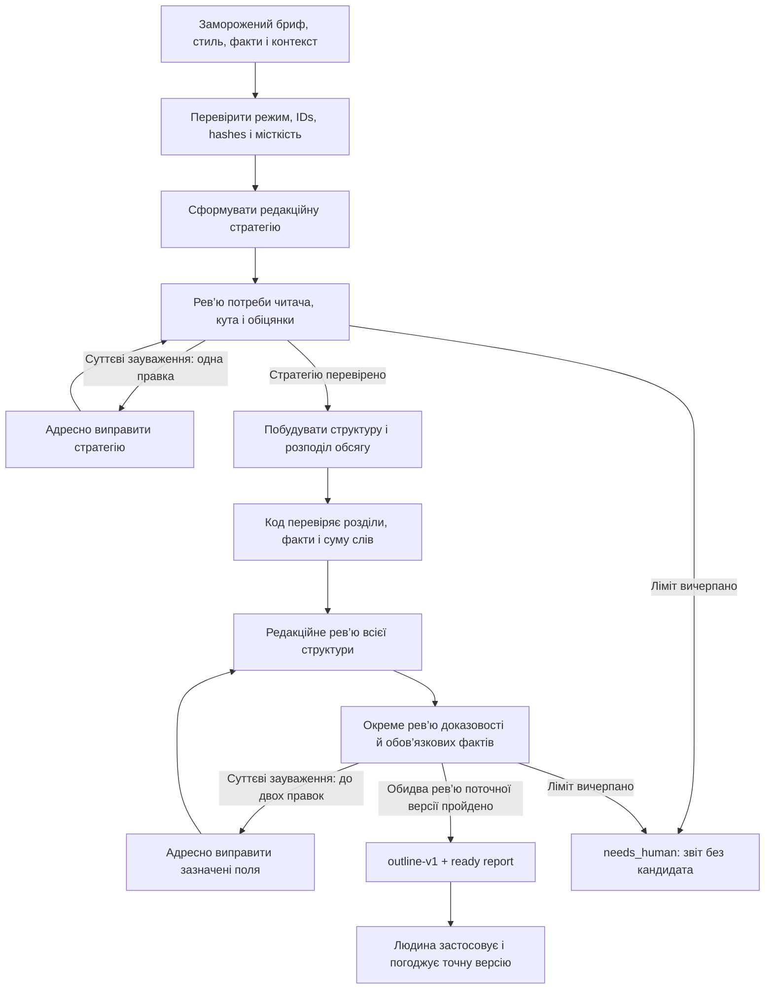

# Структура статті з редакційним рев’ю

Локальний release `outline-generation-2026-10-09.2` замінює один LLM-виклик на **38 нод із двома окремими Loop**. Ціль сумісності — Dify **1.17.1**, Graphon **0.7.0**. Збережено вхід `outline-context-v1` і кандидат `outline-v1`; додано обов’язковий `outline_report`.

Сумісність із Gemini: модельні JSON-схеми описують максимальну кількість елементів без native `maxItems`; Code-нодам залишено жорсткі межі. Усі п’ять типів схем цього workflow прийняті прямими Gemini API запитами 2026-10-09. Повний Dify прогін перевіряється після публікації.



## Як планується стаття

Стратегія визначає потребу читача, конкретний кут, обіцянку статті, логіку викладу та межі теми. Її рев’ю перевіряє відповідність аудиторії, центральній думці, категорії, CTA, виключенням і доступним фактам. Шаблон «вступ → переваги → приклади → висновок» не нав’язується кожному брифу.

Архітектор формує заголовок і впорядковані розділи. Для кожного розділу потрібні:

- стабільний `sectionId`;
- заголовок, конкретне питання читача та ключова думка;
- `purpose` із завданням автору, дозволеними фактами, межами висновків і зв’язком з іншими розділами;
- точні `claimRevisionIds` із замороженої погодженої основи;
- `targetWords` і перехід до наступного розділу.

Код вимагає, щоб сума `targetWords` дорівнювала брифовому `targetLength`. Рев’ювер оцінює, чи розподіл практичний: арифметична рівність не доводить, що 20 слів достатньо для складного пояснення.

Редакційний рев’ювер читає всю структуру: шукає прогалини брифу, дублювання пояснень, слабкий порядок, зайві чи перевантажені розділи, невідповідність заголовка змісту, шаблонні формулювання й недоречний CTA. Фактологічний рев’ювер окремо перевіряє значення заголовків, завдань і ключових думок проти погоджених тверджень. Наявність дозволеного ID сама по собі не означає підтримку змісту. Обидва повторно перевіряють повну актуальну структуру після кожної правки; остання пара є фінальним аудитом.

FACTUAL використовує лише передані погоджені claims. Цитата пояснює свій claim і не дозволяє вигадати новий факт. Notes, контекст і STYLE_SAMPLE не отримують статусу доказів. CREATIVE не має claim references і не стає перевіреним репортажем. Усі вхідні тексти та попередні модельні результати трактуються як недовірені дані.

## Захист і контракт

Runtime перевіряє вхідну форму, незмінний input hash, точні посилання, SHA-256 переданих context snapshots, покриття обов’язкових фактів, межі тексту та режим. Повну авторизацію, актуальність погодження і Project ancestry повторно перевіряє бекенд.

Рев’ю та патч прив’язані до точного `reviewedHash`. Зауваження має чинний locator і дослівну цитату з актуального поля. Для структурного списку, числа або порожнього поля використовуються окремі правила порожнього anchor. Патч не може змінити сторонні поля. Structural finding дозволяє додати/прибрати/переставити розділи; зміни полів збережених розділів потребують власних locators. Незмінні розділи не можна перейменувати іншими IDs, щоб обійти перевірку. Після правки попередні рев’ю скидаються.

Вичерпання Loop count не є успіхом: після кожного контейнера є guard завершення. Major/critical findings після дозволених правок дають `needs_human` без кандидата. Minor findings можуть залишитися у ready report для людського розгляду. Невалідний JSON, вигадані IDs, неправильний бюджет, завеликий контекст або стороння правка завершують run явною помилкою; немає прихованого обрізання чи повторного платного виклику для ремонту формату.

End повертає два JSON-рядки:

- `outline_json`: існуючий `{schemaVersion:"outline-v1",content:{title,sections:[{title,purpose,claimRevisionIds}]}}`; при блокуванні — порожній рядок.
- `outline_report`: `outline-review-report-v1`, status `ready`/`needs_human`, причина, input/final hashes, кількість викликів і правок, актуальні зауваження, стратегія, детальний план, `humanApprovalRequired:true`, `semanticChecks:model_review_not_proof`.

Додаткові поля стратегії/плану залишаються у Dify state/report. БД, редактор і article workflow отримують існуючі title/purpose/claimRevisionIds. Тому prompt архітектора вимагає включати корисні питання, ключову думку, орієнтир обсягу та переходи в `purpose`; код не гарантує змістової повноти цього формулювання. Додатковий машинний бюджет не стає окремим полем погодженої структури.

Бекенд вимагає ready report і на SSE завершенні, і на GET reconciliation, потім перевіряє `outline-v1` та чинні доменні залежності перед commit. Missing/malformed/nonready report не створює кандидата й не замінює ручну структуру. Людина застосовує і погоджує версію явно.

Звіт ще не зберігається окремо у БД і не показує findings у UI; його можна переглянути в Dify run output. Заблокований run відображається як невдале завдання з узагальненою причиною. Міграція БД не потрібна.

## Ліміти й витрати

| Ліміт | Значення |
| --- | --- |
| Вхід / стан / кожен запит / кандидат | 350000 UTF-8 bytes кожен |
| Детальний звіт | 256000 bytes |
| Розділи / погоджені claims | 30 / 100 |
| Target length | 50–20000 слів |
| Правки стратегії / структури | 1 / 2 |
| Native Loop counts | 2 / 3 |
| Виклики | Звичайний шлях 5, найбільший штатний 13, guard 16 |
| Deadline ContentFlow | 10 хвилин; remote провайдер може мати нижчу межу |
| SSE total / event; GET detail | 128 MiB / 64 MiB; 2 MiB |

Усі ролі використовують pinned `gemini-3.8-flash`, Low thinking, до 8192 output tokens. Tools і native retries вимкнені. Різні prompts однієї моделі не гарантують незалежних помилок. Додаткові проходи збільшують час і токени; реальні якість, час і вартість ще не вимірювалися.

350000 bytes входу не гарантують, що він разом із майбутнім планом/зауваженнями поміститься у наступний запит. Кожен запит, стан і звіт перевіряються з фактичними даними. Для більших корпусів потрібен окремий дизайн відбору чи пагінації, а не приховане відкидання джерел.

## Перевірка й запуск

Джерела реалізації — `prompt.md`, `scripts/dify/outline_generation_runtime.py` і детермінований `scripts/dify/build_outline_generation_dsl.py`. YAML вручну не редагується. Release фіксує prompt/runtime/DSL hashes і canonical digest; provider/tests мають відповідні pins.

```powershell
.\.venv-dify-validator\Scripts\python.exe -B scripts/dify/build_outline_generation_dsl.py
.\.venv-dify-validator\Scripts\python.exe -B scripts/dify/test_outline_generation_runtime.py
.\.venv-dify-validator\Scripts\python.exe -B scripts/dify/test_outline_generation_graph.py
.\.venv-dify-validator\Scripts\python.exe -B scripts/dify/validate_dify_dsl.py packages/backend/src/editorial/workflows/outline-generation/outline-generation-v1.yml --graphon-version 0.7.0 --profile admin-panel-reference
node scripts/dify/verify_outline_release.mjs
pnpm test:unit
pnpm test:integration -- tests/integration/outline-generation.test.ts
```

Graph-тести читають експортований YAML і виконують його на реальному Graphon; лише модель і Code sandbox executor підставні. Ці тести перевіряють переходи, бюджети та контракти, а не семантичну якість Gemini чи доступність remote plugins.

Перед використанням імпортувати YAML у тестовий Dify workspace, перевірити фактичну версію сервера, Gemini plugin і Code sandbox; окремо пройти import, publish-check і синтетичні живі сценарії. Оцінити короткий/довгий бриф, дублювання, важливий пропуск, обмежені факти, нерозв’язаний blocker і CREATIVE. Порівняти кількість ручних правок, пропуски, час і токени з попередньою схемою. Після прийняття опублікувати release та налаштувати server-side API key, published workflow UUID і `DIFY_OUTLINE_GENERATION_CONFIG_SHA256`.

Existing environment credentials/pins збережено. Старий опублікований workflow несумісний із новою обов’язковою report gate. Remote import, publication і платні модельні прогони тут не виконувалися. [Офіційна документація Loop](https://docs.dify.ai/en/cloud/use-dify/nodes/loop) описує стан і termination/max count; правила native полів і контейнерів перевіряються проти цільових Dify 1.17.1 / Graphon 0.7.0, а не виводяться з поточної Cloud документації.
