# Редакційний workflow Telegram

Локальний release `telegram-generation-2026-10-10.2` генерує окремий допис Telegram для маршрутів `DIRECT` і `ARTICLE_DERIVED`. Ціль імпортованого DSL — Dify **1.17.1** з Graphon **0.7.0** і плагіном Gemini `langgenius/gemini/google`, модель `gemini-3.8-flash`. Статична сумісність і граф перевіряються локально; імпорт, publish-check, доступність моделі в конкретному workspace та якість живого тексту — окремі перевірки.

## Потік

Реліз `.2` прибирає standalone CLI-блок лише з вбудованого Code-node runtime: він спричиняв `IndexError` у першому вузлі опублікованого `.1`. Усі експортовані Code nodes і повний Graphon-граф тепер перевіряються з `__name__="__main__"`, без аргументів CLI. Окремий запуск runtime збережено. Prompt, factual guards і межа чотирьох model calls не змінені.

Для розгортання імпортуй поточний `telegram-generation-v1.yml` в існуючий Telegram app і опублікуй його. Після публікації онови фактичний workflow UUID і `DIFY_TELEGRAM_CONFIG_SHA256=d3254a4306bae3707068f1159020eb37d9783679f13993d6793c2d03fdbcf8a7`, перезапусти API/worker і виконай `node scripts/dify/live_telegram_checks.mjs --live --output-dir docs/live-dify-2026-10-10/telegram-fixed-published`. Активний `.env` під час підготовки виправлення не змінювався.

Живий повторний прогін після публікації `.2`: підтверджений Workflow API ID; 10 із 11 сценаріїв технічно пройшли. Один сценарій двічі виявив, що перевірка помилково приймає описові факти за відповідь на бриф про ефективність курсу. Це окрема від виправлення запуску редакційна прогалина; оцінка і приклади — в `docs/LIVE_DIFY_TELEGRAM_RETEST_2026-10-10.md`.

```mermaid
flowchart LR
    A[Заморожені бриф, стиль, факти, контекст і за потреби стаття] --> B[Перевірка входу]
    B --> C[Написати абзаци сегментами]
    C --> D[Перевірити allowed IDs і покриття]
    D --> E[Незалежне повне редакційне та фактологічне рев’ю]
    E -->|Є адресні зауваження| F[Одна правка лише названих абзаців]
    F --> G[Повторне рев’ю зміненого тексту]
    E -->|Готово або потрібна людина| H[Детермінований фінальний guard]
    G --> H
    H --> I[telegram-v1 або звіт без кандидата]
```



Writer повертає лише абзаци й сегменти тексту з claim/evidence IDs. Runtime повторно перевіряє кожну пару ID, обов’язкові факти та обмеження входу. Для FACTUAL кожен текстовий сегмент має точну дозволену пару й стає evidence mapping; для CREATIVE mappings порожні й звіт явно позначає текст неперевіреним. Reviewer оцінює весь допис, а не довіряє IDs як доказу семантичної точності. Одна правка може замінити лише абзаци, названі його перевіреними finding locator-ами; повний змінений текст проходить повторне рев’ю.

Код з’єднує текст, додає розділення між абзацами, визначає mapping quote та рахує half-open offsets у UTF-16 code units, як JavaScript `String.length`. Модель не подає offsets. Коли `includeLink=true`, код додає буквальний `[ПОСИЛАННЯ]`, якщо його ще немає, і повторно перевіряє ліміт. Вихід обмежено 4096 UTF-16 units і 100 mappings. Джерельна стаття/URL не потрібні.

## Вхід, результат і межі

`editorial_json` — JSON `telegram-context-v1`:

```json
{
  "schemaVersion": "telegram-context-v1",
  "inputMode": "DIRECT",
  "contentMode": "FACTUAL",
  "includeLink": false,
  "brief": {"requiredClaimRevisionIds": []},
  "style": {"brandbook": "", "tone": "", "settings": {}},
  "claims": [],
  "context": [],
  "article": null
}
```

`DIRECT` вимагає `article: null`; `ARTICLE_DERIVED` вимагає `{versionId, sha256, text}`, де `sha256` — заморожений content hash ArticleVersion. Runtime перевіряє UUID/hash формат і розмір, а сервер окремо перевіряє, що ця незмінна версія досі відповідає manifest. Вибрані source contexts містять SHA-256 свого normalized text; runtime перевіряє ці hashes. `brief` має той самий вміст, що й `OutlineProviderInput`; `claims` та `context` містять заморожені версії, вибрані сервером. Усі рядки є недовіреними даними. Runtime перевіряє фактологічні refs, мапінги й покриття required claims. Основна серверна перевірка ancestry, актуальності та права доступу лишається на боці ContentFlow.

End повертає два рядки:

- `telegram_json`: серіалізований `telegram-v1` `{schemaVersion, content:{text,mappings}}`; порожній рядок, якщо потрібне втручання людини або бракує доказів.
- `telegram_report`: `telegram-editorial-report-v1` зі статусом `ready`, `needs_human` або `insufficient_evidence`, `contentHash`, причинами та результатами детермінованої перевірки. `contentHash` — lowercase SHA-256 від UTF-8 `JSON.stringify` parsed `telegram-v1` результату для `ready`, і `null`, коли кандидата немає.

`ready` і проходження рев’ю не є людським погодженням чи доказом істинності. Застосунок окремо перевіряє контракт, evidence та залежності. Workflow нічого не публікує і не схвалює. Після другої перевірки будь-який невирішений суттєвий finding блокує кандидата. Нативні повтори LLM вимкнені; максимальний шлях — чотири model calls.

## Відтворення та локальна перевірка

З кореня репозиторію у PowerShell:

```powershell
.\.venv-dify-validator\Scripts\python.exe -B scripts\dify\build_telegram_generation_dsl.py
.\.venv-dify-validator\Scripts\python.exe -B scripts\dify\test_telegram_generation_runtime.py
.\.venv-dify-validator\Scripts\python.exe -B scripts\dify\test_telegram_generation_graph.py
.\.venv-dify-validator\Scripts\python.exe -B scripts\dify\validate_dify_dsl.py --self-test
.\.venv-dify-validator\Scripts\python.exe -B scripts\dify\validate_dify_dsl.py packages\backend\src\editorial\workflows\telegram-generation\telegram-generation-v1.yml --graphon-version 0.7.0
```

Graph tests виконують експорт на реальному Graphon 0.7.0; синтетичними є лише відповіді LLM і локальний Code executor. Перевіряються обидва contentMode, обидва inputMode, repair/rereview, insufficient evidence, нерозв’язане рев’ю та недозволена правка. Це не доводить імпорт чи роботу Dify cloud, наявність plugin credentials або якість моделі. Зміни не імпортують і не публікують app, не роблять provider calls і не читають файли секретів.

Джерела артефактів: `prompt.md`, `scripts/dify/telegram_generation_runtime.py` і `scripts/dify/build_telegram_generation_dsl.py`. Builder детерміновано генерує YAML і `release.json` з SHA-256 для prompt, runtime, DSL та канонічним `configDigest`. `release.json` — метадані API-релізу, не файл для імпорту в Dify.
